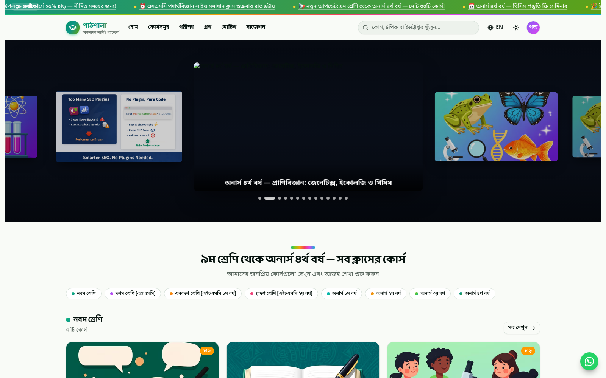
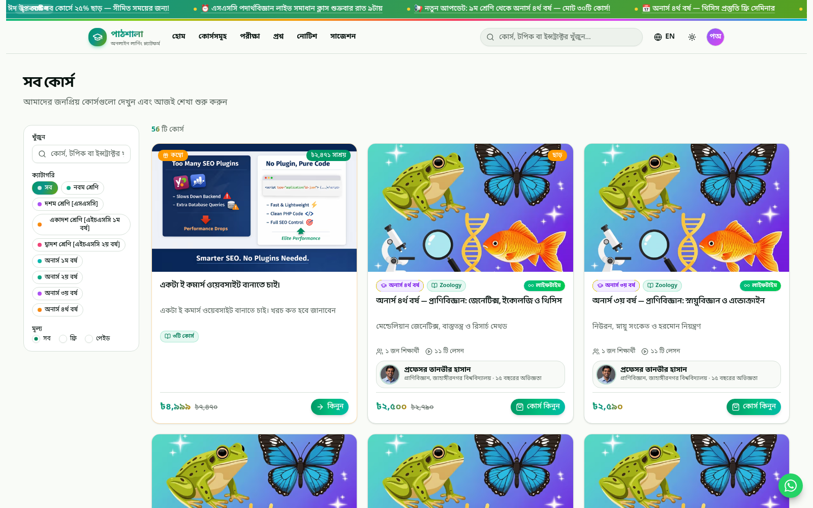
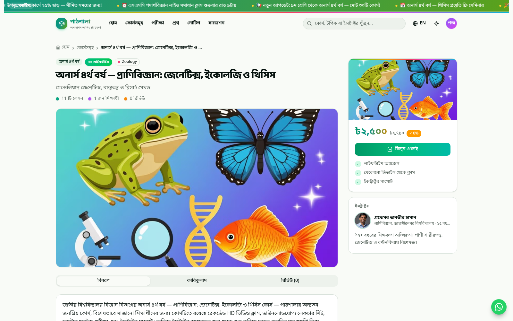
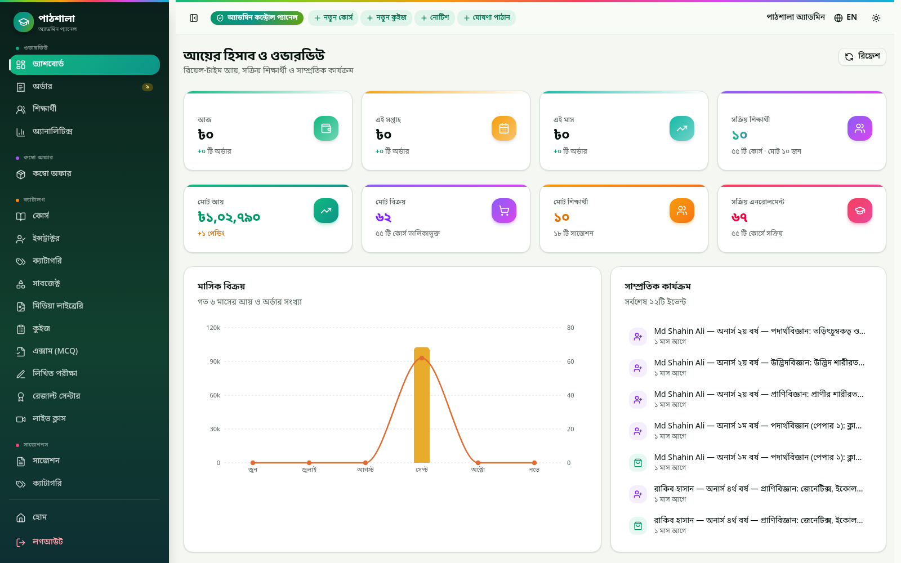
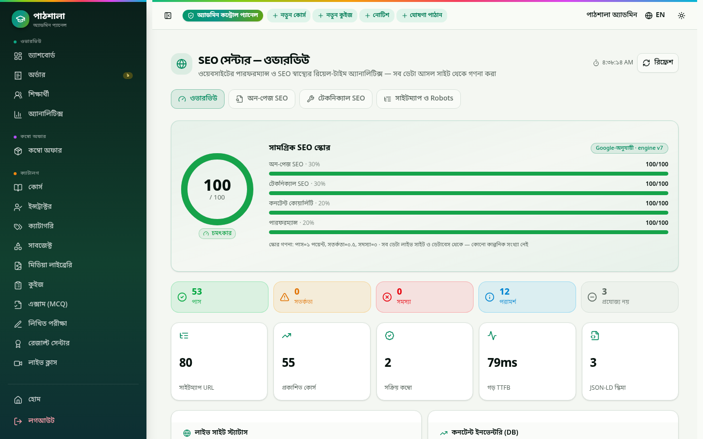

<div align="center">


# PathShala LMS

**A complete, production-grade online learning platform for Bangladeshi students — from Class 9 through Honours.**

Courses · Video lessons · MCQ & written exams · Live classes · Certificates · Payments · Full admin panel


[](https://github.com/mdshahinalidm/pathshala-lms/actions/workflows/ci.yml)


[Overview](#overview) · [Features](#features) · [Tech stack](#tech-stack) · [Getting started](#getting-started) · [Deployment](#deployment) · [Project structure](#project-structure)

**55+ seeded courses** · **40+ REST endpoints** · **68-check SEO audit engine** · **20+ Prisma models** · **bKash + SSLCommerz payments** · **Bangla ⇄ English**

</div>

---

## Overview

PathShala is a full-stack Learning Management System built for the Bangladeshi education market. It ships three complete applications in one codebase:

| Surface | Description |
|---|---|
| **Public site** | Marketing home, course catalog, exam center, combo packages, free study-material library, notices, GPA/CGPA tools, legal & contact pages |
| **Student dashboard** | Classroom (video/PDF lessons), quiz runner with instant grading, written-exam submissions, results, certificates, orders, notifications, profile |
| **Admin panel** | 25+ management modules — courses, exams, result center, orders, students, coupons, combos, media library, broadcast, site settings with 21 sub-modules, and a live **SEO Center** |

Everything is fully **bilingual (Bangla ⇄ English)** with instant switching, **light/dark themed**, and **mobile-first responsive** — from the storefront to the admin panel.

<p align="center">
  
</p>
<p align="center">
  
  &nbsp;
  
</p>
<p align="center">
  
  &nbsp;
  
</p>
<p align="center">
  
</p>

## Features

### Learning experience
- **Course catalog** — 56 seeded demo courses across every class and board, category filters, search, ratings and moderated reviews
- **Classroom** — chapter/lesson player for video (YouTube, Vimeo, Drive, Bunny, self-hosted) and PDF lecture sheets, per-lesson progress tracking, guest previews
- **MCQ exams** — timed quizzes with negative marking, instant auto-grading, per-subject breakdowns and leaderboards
- **Written (CQ) exams** — question papers, answer-sheet uploads, admin annotation and a full result-publishing pipeline
- **Live classes** — scheduled sessions with join links on both student and admin sides
- **Study-material library** — free & purchasable suggestions (PDF downloads with inline preview)
- **Certificates** — auto-issued on course completion with a public serial verification page
- **Academic tools** — GPA calculator, CGPA calculator and marks-to-percentage tools

### Commerce
- **Cart & checkout** — course, combo, exam and suggestion purchases with discount pricing
- **Coupons** — scoped discount codes (courses / exams / suggestions) with usage tracking
- **Payment gateways** — bKash Tokenized Checkout and SSLCommerz out of the box (sandbox mode), plus a manual/verification flow for offline payments
- **Invoices** — generated per order with printable layout

### Admin panel
- **Analytics dashboard** — revenue, orders, enrollments and weekly trends with charts
- **Course builder** — chapters, lessons, rich content, media uploads up to 512 MB, pricing and validity windows
- **Exam & result center** — question banks, MCQ/CQ exam management, submission review with annotation tools, one-click result publishing
- **People & roles** — students, instructors, custom badges, role-based access (Admin / Manager / Moderator)
- **Site settings — 21 focused sub-modules** — branding, hero carousel variants, stat strips, preloader, header-menu & footer editors, SEO verification & GA4, custom CSS/code injection, login/registration toggles, SMTP, SMS gateway, payment numbers, popup, WhatsApp, invoices and more
- **Communications** — notices, broadcast messaging, contact inbox, testimonials manager
- **Media library** — content-addressed uploads with dedupe, reusable across the whole panel

### Platform engineering
- **SEO Center** — live scores (overall / technical / content / on-page) driven by a **68-check audit engine** (27 on-page + 41 technical), per-issue fix guidance, Google Search Console readiness
- **Instant sitemap** — content-revision-driven regeneration: publish anything and `sitemap.xml` is rebuilt on the very next request, per deployment domain
- **Any-domain origin resolution** — canonical URLs, OpenGraph, sitemap and robots automatically follow the actual deployment host
- **Security** — JWT session cookies, edge route guards for pages and APIs, bcrypt password hashing, OTP tokens, CSP / HSTS / anti-clickjacking headers on every route, masked paid-media streaming
- **Performance** — React `cache()` deduped server reads, content-addressed media with immutable long-term caching, per-origin sitemap caching, code-split client bundles
- **Internationalization** — complete Bangla/English dictionaries with server-side language cookie sync (no hydration flash)

## Tech stack

| Layer | Technology |
|---|---|
| Framework | Next.js 16 (App Router, Turbopack), React 19 |
| Language | TypeScript 5 (strict) |
| Styling | Tailwind CSS 4, shadcn/ui (New York), Lucide icons, Framer Motion |
| Database | Prisma ORM 6 + SQLite (swappable to any Prisma provider) |
| State | Zustand (client), TanStack Query (server state) |
| Auth | Custom JWT sessions (`jose`) + bcrypt, phone/email OTP |
| Media | Busboy streaming uploads, Sharp processing, content-addressed storage |
| Email / SMS | Nodemailer SMTP, pluggable SMS gateway |
| Payments | bKash Tokenized Checkout, SSLCommerz |
| Charts / Editors | Recharts, MDXEditor, dnd-kit |

## Architecture

```
┌────────────────────────── Browser ──────────────────────────┐
│  Public site SPA ⇄ Student dashboard ⇄ Admin panel          │
│        (zustand UI store · TanStack Query · route progress) │
└───────────────────────────┬─────────────────────────────────┘
                            │  fetch /api/** (JSON, REST)
┌───────────────────────────▼─────────────────────────────────┐
│  Next.js 16 App Router (edge + node runtimes)               │
│  • proxy.ts  — JWT guards (pages + API) & security headers  │
│  • 40+ route handlers — auth, courses, exams, orders,       │
│    payments, settings, uploads, admin modules, SEO audit    │
│  • generateMetadata — per-request SEO metadata              │
└───────────────────────────┬─────────────────────────────────┘
                            │  Prisma Client
              ┌─────────────▼─────────────┐
              │  SQLite (db/custom.db)    │
              │  20+ models: users,       │
              │  courses, lessons, quizzes│
              │  attempts, orders, certs… │
              └───────────────────────────┘
```

## Getting started

**Prerequisites:** [Bun](https://bun.sh) 1.x (or Node 20+), Git

```bash
# 1. Clone & install (postinstall generates the Prisma client)
git clone https://github.com/<your-username>/pathshala-lms.git
cd pathshala-lms
bun install

# 2. Configure environment
cp .env.example .env
#   → set JWT_SECRET (openssl rand -base64 32)

# 3. Create the database schema & seed the full demo catalog
bun run db:push
bun run db:seed

# 4. Start the dev server
bun run dev
# → http://localhost:3000
```

**Default seeded accounts**

| Role | Email | Password |
|---|---|---|
| Admin | `admin@pathshala.com` | `Admin@1234` |
| Student | `student@pathshala.com` | `Student@123` |

> Change both passwords immediately in any real deployment — Admin Panel → Settings.

### Scripts

| Command | Description |
|---|---|
| `bun run dev` | Start the dev server on port 3000 |
| `bun run build` | Production build (standalone output) |
| `bun run start` | Serve the production build |
| `bun run lint` | ESLint across the repo |
| `bun run db:push` | Push the Prisma schema to the database |
| `bun run db:seed` | Seed demo users, 56 courses, exams, orders & reviews |
| `bun run db:generate` | Regenerate the Prisma client |
| `bun run db:switch:postgres` | Swap in the PostgreSQL schema (deploy/schema.postgres.prisma) for Vercel |
| `bun run db:switch:sqlite` | Swap back to the SQLite schema for local development |

### Environment variables

| Variable | Required | Description |
|---|---|---|
| `DATABASE_URL` | yes | Prisma datasource (`file:./db/custom.db` by default) |
| `JWT_SECRET` | yes | Session signing secret — `openssl rand -base64 32` |
| `NEXT_PUBLIC_SITE_URL` | yes | Public base URL for metadata/sitemap (auto-follows the request host when unset per domain) |
| `SMTP_HOST` / `SMTP_PORT` / `SMTP_USER` / `SMTP_PASS` / `SMTP_FROM` | no | Contact-form & notification email |
| `SMS_API_URL` / `SMS_API_KEY` / `SMS_SENDER_ID` | no | Phone-OTP login gateway |

## Deployment

### Vercel / serverless (PostgreSQL)

Full step-by-step guide: **[deploy/VERCEL.md](./deploy/VERCEL.md)**

1. Push the repo to GitHub, import it in Vercel and set `DATABASE_URL` (PostgreSQL), `JWT_SECRET` and `NEXT_PUBLIC_SITE_URL`.
2. Create the hosted database and seed it: `bun run db:switch:postgres` → `db:push` + `db:seed` against the `postgresql://` connection string.
3. Set the Vercel **Build Command** to `bun run db:switch:postgres && bun run build` — the PostgreSQL Prisma schema (`deploy/schema.postgres.prisma`) is swapped in automatically on every deploy.
4. The committed repo still defaults to SQLite for frictionless local development; switch back anytime with `bun run db:switch:sqlite`.

### VPS / self-hosted
```bash
bun run build
bun run start          # serves .next/standalone on :3000
```
Run it under PM2 or systemd, terminate TLS with Nginx/Caddy, and point `NEXT_PUBLIC_SITE_URL` at your domain — canonical tags, OpenGraph and the sitemap follow it automatically.

## Project structure

```
src/
├── app/
│   ├── (public)/        # Storefront: home, courses, exams, combos, tools…
│   ├── admin/           # Admin panel (edge-guarded, role-checked)
│   ├── dashboard/       # Student dashboard (edge-guarded)
│   ├── api/             # 40+ REST route handlers
│   ├── sitemap.xml/     # Instant, per-domain XML sitemap
│   ├── robots.txt/      # Robots handler
│   └── layout.tsx       # Server settings, per-request metadata
├── components/
│   ├── ui/              # shadcn/ui primitives
│   ├── layout/          # Header, footer, shells, popups
│   ├── views/           # Feature views (public / dashboard / admin / tools)
│   └── shared/          # Course cards, dialogs, media components
├── lib/                 # Auth, payments, OTP, grading, SEO audit engine…
├── store/               # Zustand UI + auth stores
└── hooks/               # Shared client hooks
prisma/                  # Schema, demo seed (56 courses), extras
docs/screenshots/        # App screenshots
```

## License

PathShala LMS is **proprietary software**. The source code in this repository is made visible for evaluation and due-diligence purposes only — copying, redistribution, modification, or commercial deployment is **not permitted** without a written commercial license from the author.

See [LICENSE](./LICENSE) for the full terms. For licensing, contact via [LinkedIn](https://www.linkedin.com/in/mdshahinalidm/).

## Author

**Md Shahin Ali** — [LinkedIn](https://www.linkedin.com/in/mdshahinalidm/)

---

© 2026 PathShala. All rights reserved.
